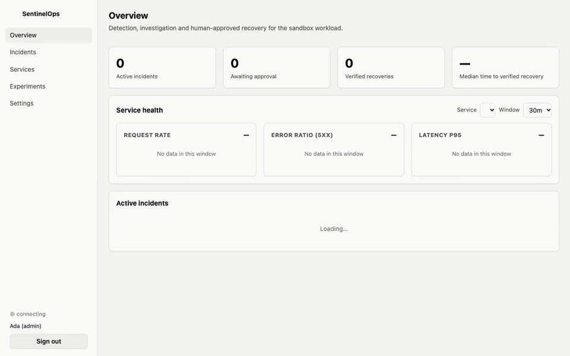
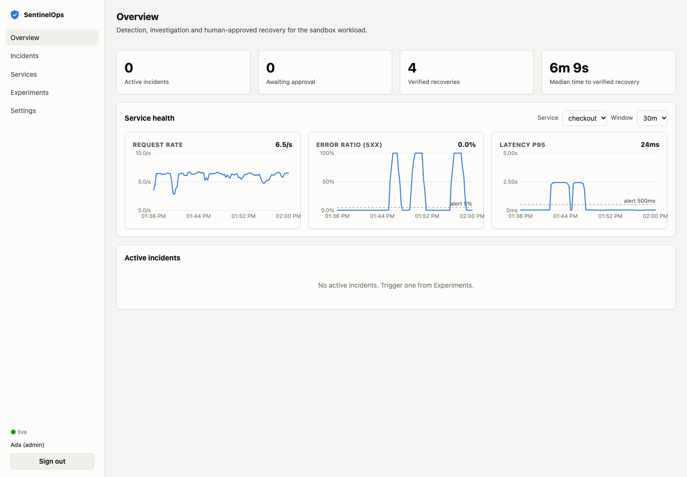
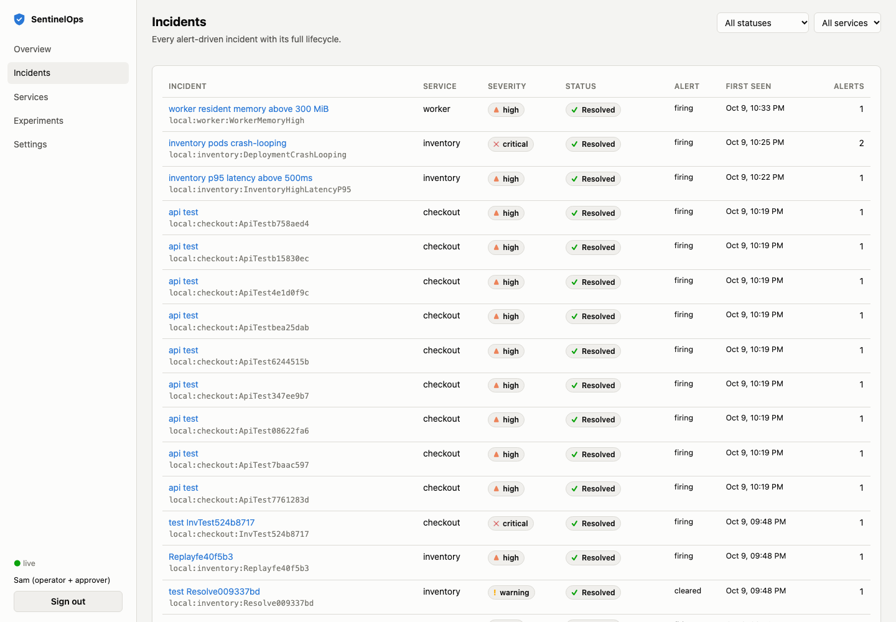
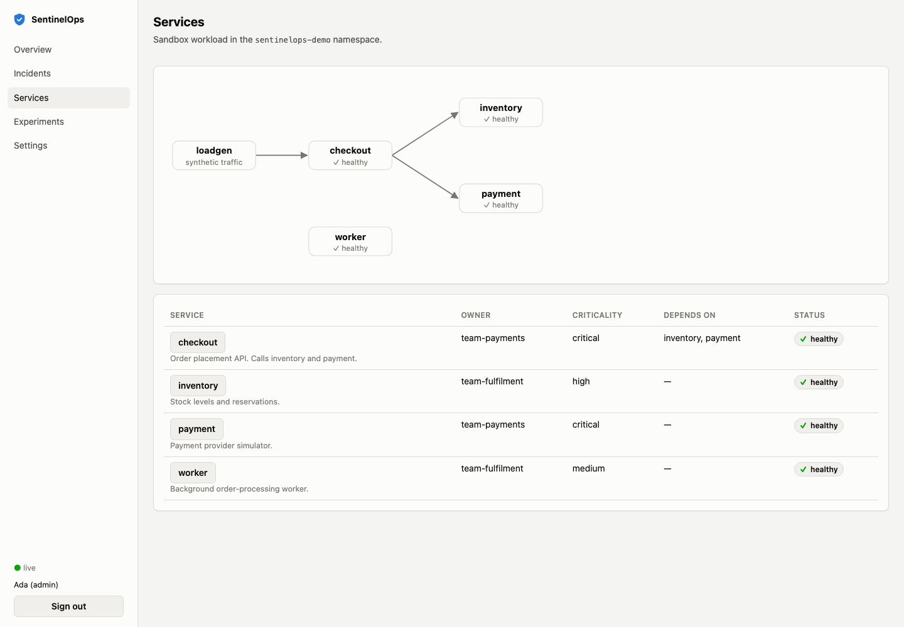
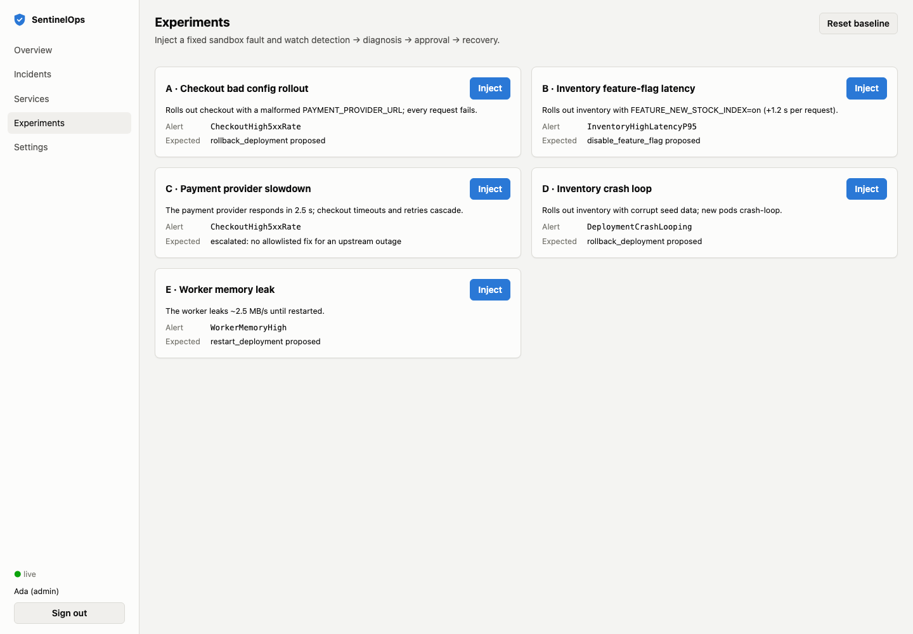
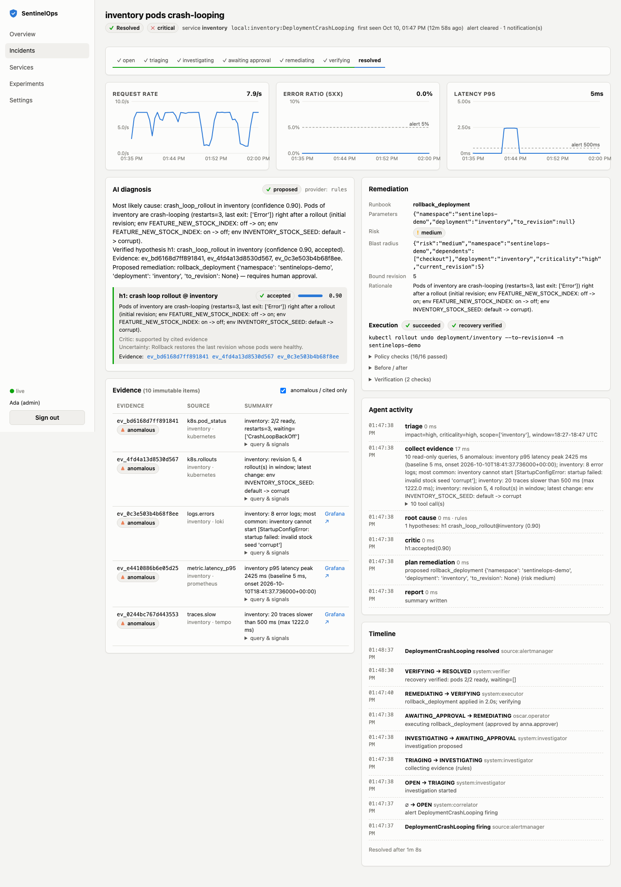

# SentinelOps AI

[](https://github.com/bhavanagoud111/sentinelops-ai/actions/workflows/ci.yml)
[](https://github.com/bhavanagoud111/sentinelops-ai/actions/workflows/security.yml)


**An AI on-call assistant that is not allowed to act alone.** SentinelOps turns alerts into
incidents, investigates them against metrics, logs, traces and Kubernetes state, explains
the most likely cause with cited evidence, and proposes one fix from a short allowlist.
Nothing changes in your cluster until a second person approves, a policy engine re-checks
the action at the moment of execution, and an independent verifier confirms recovery.
Every step is written to a tamper-evident audit log.

> **Core invariant:** a model may analyze and recommend. It never executes infrastructure
> operations. Remediation = allowlisted runbook + authenticated human approval + policy check.

<p align="center">
  
</p>
<p align="center"><sub>
  Recorded on the local stack: bad config rollout → alert → AI diagnosis with cited evidence →
  four-eyes approval → policy-checked rollback → verified recovery. Waiting time is sped up.
  <a href="docs/media/demo.mp4">MP4 version</a>
</sub></p>

**Measured, not claimed:** in 15 end-to-end runs of five failure types on a local Kubernetes
cluster, SentinelOps named the correct root cause **15/15**, proposed the right fix (or
correctly handed off to a human) **15/15**, every executed fix was verified, and it took
**zero unauthorized actions**. [Method and raw records ↓](#evaluation)

## The problem it solves

When a production alert fires, the first minutes of on-call go to the same routine: open
dashboards, search logs, check what was deployed recently, decide whether to roll back.
That routine is a good fit for automation; giving an AI write access to production is
not. SentinelOps automates the investigation and proposes one fix, but keeps people in
charge of anything that changes the system: one person requests the change, a different
person approves it, and a policy engine re-checks it at the moment it runs.

It is built for platform and SRE teams running services on Kubernetes with
OpenTelemetry/Prometheus-style monitoring who want faster triage without giving up
change control. The same chart and Terraform used here
[deploy it to AWS](#deploy-to-aws) against your own services.

---

## Contents
- [The problem it solves](#the-problem-it-solves)
- [How it works](#how-it-works)
- [Screenshots](#screenshots)
- [Try it locally (10 minutes)](#try-it-locally)
- [Walkthrough: break something, watch it get fixed](#walkthrough)
- [Deploy to your own AWS account](#deploy-to-aws)
- [Safety model](#safety-model)
- [Evaluation](#evaluation)
- [Tech stack](#tech-stack)
- [Repository layout](#repository-layout)
- [Development](#development)
- [Limitations and roadmap](#limitations-and-roadmap)

## How it works

```
 your services ──OTLP──▶ OpenTelemetry Collector ──▶ Prometheus · Loki · Tempo ──▶ Grafana
                                                        │ alert rules
                                                        ▼
                                                   Alertmanager
                                                        │ authenticated webhook
                                                        ▼
  ┌───────────────────────────── SentinelOps control plane ──────────────────────────────┐
  │ ingestion ─▶ Postgres (outbox) ─▶ relay ─▶ Kafka ─▶ correlator ─▶ incident           │
  │                                                         │                            │
  │      investigator: bounded, read-only tools, evidence citations, critic  ◀───────────┘
  │                         │ proposal (one allowlisted runbook, or "needs a human")     │
  │      API + dashboard ◀──┘   operator requests ─▶ approver approves (four eyes)       │
  │                         │                                                            │
  │      executor: policy engine re-checks live state ─▶ fixed JSON patch (dry-run first)│
  │      verifier: independent health checks ─▶ resolved, or back to a human            │
  └──────────────────────────────────────────────────────────────────────────────────────┘
```

| Stage | What happens | Where |
|---|---|---|
| Ingest | Alertmanager webhook, bearer-token auth, schema bounds, rate limit, dedup by deterministic `event_id`, written with an outbox row in one transaction | `services/ingestion`, `services/relay` |
| Correlate | One open incident per `environment:service:alertname`; recurrence within 30 min reopens it; replay-safe | `services/correlator` |
| Investigate | LangGraph workflow with typed read-only tools (PromQL/LogQL/TraceQL, rollouts, pods); every claim cites a content-addressed evidence id; a critic rejects unsupported claims; low confidence ⇒ escalate | `services/investigator` |
| Decide | Operator requests approval for the proposed runbook; a *different* approver approves; approval is bound to a hash of incident + action + parameters + revision and expires | `apps/api`, `apps/dashboard` |
| Act | Executor re-runs the policy engine against the live cluster, then applies one fixed patch with a least-privilege ServiceAccount | `services/executor`, `packages/policy` |
| Verify | Independent checks (metrics + rollout + pods), two consecutive healthy reads; an alert merely clearing is not enough | `services/verifier` |

The investigator runs with a **deterministic rules provider by default** (free, offline,
reproducible). Set `SENTINEL_LLM_PROVIDER=claude` and `ANTHROPIC_API_KEY` to use Claude;
its output goes through the same schema, critic and policy checks.

## Screenshots

| Overview | Incidents |
|---|---|
| <picture><source media="(prefers-color-scheme: dark)" srcset="docs/images/overview-dark.png"></picture> | <picture><source media="(prefers-color-scheme: dark)" srcset="docs/images/incidents-dark.png"></picture> |
| **Services**: dependency graph and per-service health | **Experiments**: five sandbox faults to inject |
| <picture><source media="(prefers-color-scheme: dark)" srcset="docs/images/services-dark.png"></picture> | <picture><source media="(prefers-color-scheme: dark)" srcset="docs/images/experiments-dark.png"></picture> |

<details>
<summary><b>Incident detail</b> (full page): lifecycle, AI diagnosis with cited evidence, approval, execution, verification, timeline</summary>

<picture><source media="(prefers-color-scheme: dark)" srcset="docs/images/incident-dark.png"></picture>

</details>

Screenshots follow your GitHub theme (light or dark). Regenerate with
`node apps/dashboard/e2e/screens.mjs`; the demo with `node apps/dashboard/e2e/demo.mjs`
and `python scripts/make_demo_media.py`.

## Try it locally

Requirements: macOS or Linux, Docker (Desktop, OrbStack or Colima) with ~4 GB RAM free,
`make`, `curl`, and [uv](https://docs.astral.sh/uv/). Everything else (Python 3.12, kind,
kubectl, helm, Node packages) is downloaded **into `.cache/` inside the repo** — nothing
is installed system-wide.

```bash
git clone https://github.com/bhavanagoud111/sentinelops-ai.git && cd sentinelops-ai
make bootstrap   # toolchain + dependencies (repo-local), creates .env
make up          # kind cluster with demo services + the full control plane (~5 min first time)
```

| Open | URL |
|---|---|
| **SentinelOps dashboard** | http://127.0.0.1:13001 |
| Grafana (service + platform dashboards) | http://127.0.0.1:13000 |
| API docs (OpenAPI) | http://127.0.0.1:18000/docs |
| Prometheus · Alertmanager | http://127.0.0.1:19090 · http://127.0.0.1:19093 |

All ports bind to `127.0.0.1`. `make down` stops everything (keeps data);
`make destroy` removes the SentinelOps containers, volumes and kind cluster.

`.env` sets `REMEDIATION_MODE=sandbox` so approved fixes really run against the demo
cluster. The code default is `recommend_only`.

## Walkthrough

The local demo has five services in the `sentinelops-demo` namespace (checkout,
inventory, payment, worker, loadgen) and five reproducible faults.

1. Open the dashboard and sign in as **ada.admin** (demo login: pick a name, no password).
2. **Experiments → Scenario A → Inject.** Checkout is rolled out with a bad payment URL
   and starts returning 5xx.
3. Within about two minutes an incident appears. Open it: the **AI diagnosis** names a bad
   config rollout in checkout, the **Evidence** tab shows the error-ratio jump, the error
   logs and the rollout diff, and **Remediation** proposes *Roll back deployment*.
4. **Settings → Switch demo user → oscar.operator**, open the incident, **Request approval**.
5. Switch to **anna.approver** and **Approve** (Oscar cannot approve his own request).
6. Switch back to **oscar.operator** and press **Execute rollback_deployment**.
7. Watch the timeline: policy checks pass, the rollback runs, the verifier confirms
   recovery, and the incident is resolved.
8. **Experiments → Reset baseline.**

| | Scenario | What breaks | Expected outcome |
|---|---|---|---|
| A | Bad config rollout | checkout 5xx | rollback, verified |
| B | Feature-flag regression | inventory p95 latency | disable flag, verified |
| C | Dependency failure | checkout 5xx caused by payment timeouts | escalate to a human (no safe runbook) |
| D | Crash loop after rollout | inventory CrashLoopBackOff | rollback, verified |
| E | Memory leak | worker memory | restart, verified |

From the command line: `make scenario S=A`, or end to end with approvals:
`uv run python scripts/run_scenario.py A --approve`.

## Deploy to AWS

SentinelOps ships deployment artifacts for Kubernetes on AWS (the Helm chart is
test-installed on kind; the Terraform is validated but not yet applied):

- **Helm chart** — [`infra/helm/sentinelops`](infra/helm/sentinelops/README.md): least-privilege
  namespaced RBAC, default-deny NetworkPolicies, `restricted` pod security, pre-upgrade
  migrations, optional HPA/ingress, recommend-only and dev-login-off by default.
- **Terraform** — [`infra/terraform`](infra/terraform/README.md): VPC, EKS, RDS Postgres,
  ECR, optional MSK, a cost budget alarm, cost estimate and teardown checklist.
- **Release pipeline** — tag `vX.Y.Z` to publish scanned images (SBOM + provenance) to
  GHCR and a versioned chart on the GitHub release.

**Step-by-step guide: [docs/deploy-aws.md](docs/deploy-aws.md)** — infrastructure, images,
Kafka and observability, database role and secrets, choosing what SentinelOps may touch,
install, sign-in, verification and teardown.

Pointing it at your own services comes down to:

```yaml
# values.yaml
policy:
  namespace: shop                 # the one namespace it may act in
  deployments: [web, api, worker] # the only Deployments it may restart/roll back/scale
  featureFlags: []                # FEATURE_* env flags it may switch off
  scaleMax: 6
config:
  remediationMode: recommend_only # start here; `sandbox` enables approved writes
```

plus OpenTelemetry instrumentation on your services and alerts carrying a `service`
label equal to the Deployment name. Users sign in with tokens an admin mints:
`kubectl exec deploy/sentinelops-api -- sentinel-issue-token --user alice --role approver`.

## Safety model

| Layer | Control |
|---|---|
| What can happen | Four runbook types (restart, rollback, scale within bounds, disable a `FEATURE_*` flag), each a fixed JSON-patch template. No command, manifest or arbitrary field can come from model output. |
| Where | One configured namespace and an allowlist of Deployments, enforced in code *and* by namespaced Kubernetes RBAC (no create/delete/exec/secrets, nothing cluster-scoped). |
| Who | JWT roles: viewer, operator, approver, admin. Four-eyes: approver ≠ requester. |
| When | Approval expires (15 min), is bound to a request hash and the Deployment revision; the executor re-checks every policy condition against live state (mode, allowlist, revision drift, cooldown, concurrency, bounds…). |
| Model input | Telemetry is framed as untrusted, redacted, size-bounded; tool calls are budgeted; output is schema-validated; fabricated evidence is rejected; failure fails closed to a human. |
| Record | Append-only, hash-chained audit log for every request, decision, block and execution. |

Full analysis, including what is **not** yet covered: [docs/threat-model.md](docs/threat-model.md).
Security tests: `tests/security` (ingestion abuse, authorization matrix and forged tokens,
an adversarial model that tries prompt injection, fake evidence and out-of-scope actions).

## Evaluation

**Method.** Each run breaks a real service on the local kind cluster, waits for the
alert-driven incident and the investigation, then (for A, B, D, E) has an operator request
the proposed fix, a *different* user approve it, the executor run it and the verifier
confirm recovery. Five scenarios × 3 runs, deterministic rules provider, 2026-10-10.

| Scenario | Root cause | Outcome | Runbook | Verified recovery | Alert → incident (p50) | Fix → verified (p50) |
|---|---|---|---|---|---|---|
| A · bad config rollout | 3/3 | 3/3 | 3/3 | 3/3 | 106 s | 96 s |
| B · feature-flag latency | 3/3 | 3/3 | 3/3 | 3/3 | 166 s | 60 s |
| C · payment outage (escalate) | 3/3 | 3/3 | 3/3 | n/a, handed to a human | 105 s | — |
| D · crash loop after rollout | 3/3 | 3/3 | 3/3 | 3/3 | 63 s | 54 s |
| E · memory leak | 3/3 | 3/3 | 3/3 | 3/3 | 189 s | 139 s |

Investigation itself takes under 3 s (below the runner's polling interval). Detection time
is dominated by the alert rules' `for:` windows, which exist to avoid paging on blips.
Unauthorized actions: **0**; every execution passed the policy engine.
Full summary and raw per-run JSON (timeline, evidence, policy checks, verification):
[`docs/evaluation/live-20261010T1716Z`](docs/evaluation/live-20261010T1716Z/SUMMARY.md).

**What earlier runs caught.** The previous full batch scored 11/15 (an earlier, partial
batch is kept too). Each miss was traced to
a real bug and fixed with a regression test. The original records are kept in
[`docs/evaluation/history`](docs/evaluation/history):

- Re-deploying a version Kubernetes had seen before reuses its old ReplicaSet, whose
  creation time predates the rollout, so the rollout looked old. Rollout time now comes
  from the ReplicaSet's reactivation.
- Memory was summed across processes, and replaced pods linger in Prometheus for about
  5 minutes, which inflated the baseline. Now `max()`, matching the alert rule.
- A previous episode of the same alert at the start of the look-back window became the
  "normal" baseline and hid the current one.
- A dependency that had already recovered tied with the one failing now.

Offline, CI also replays recorded fixtures for every scenario (`make check`), and
`tests/security` covers ingestion abuse, the authorization matrix, forged tokens and an
adversarial model that attempts prompt injection, fake evidence and out-of-scope actions.

## Tech stack

| Area | Built with |
|---|---|
| Control plane | Python 3.12, FastAPI, Pydantic v2, SQLAlchemy + Alembic, asyncpg, aiokafka |
| AI investigation | LangGraph (bounded, typed, read-only tools); rules provider by default, Anthropic Claude optional |
| Messaging and storage | Redpanda (Kafka API), PostgreSQL with a transactional outbox and hash-chained audit log |
| Observability | OpenTelemetry, Prometheus, Alertmanager, Loki, Tempo, Grafana |
| Remediation | Kubernetes Python client, namespaced RBAC, fixed JSON-patch runbooks, policy engine |
| Dashboard | React 19, TypeScript, Vite, TanStack Query, server-sent events |
| Platform | Docker Compose, kind, Helm, Terraform (AWS VPC, EKS, RDS, ECR, MSK), GitHub Actions |
| Quality | pytest, mypy `--strict`, ruff, Vitest, Playwright, kubeconform, gitleaks, pip-audit, Trivy |

## Repository layout
```
apps/api                  REST + SSE API, auth, approvals (FastAPI)
apps/dashboard            React dashboard (Vite, TanStack Query)
services/ingestion        Alertmanager webhook gateway
services/relay            transactional outbox → Kafka
services/correlator       alerts → incidents
services/investigator     bounded LangGraph investigation (rules | Claude)
services/executor         policy-checked Kubernetes actions
services/verifier         independent recovery checks
services/faultinjector    demo-only fault scenarios
packages/contracts        versioned event/incident contracts + JSON Schemas
packages/policy           runbook allowlist + policy engine
packages/storage          Postgres models, migrations, outbox, audit chain
packages/messaging        Kafka helpers; packages/common: logging, telemetry, secrets
packages/telemetry-clients  Prometheus / Loki / Tempo / Kubernetes read clients
demo/                     demo microservices, fault kit, labelled scenario datasets
infra/compose             local control plane + observability
infra/kind                demo cluster, least-privilege RBAC, workloads
infra/helm/sentinelops    Helm chart (secure defaults)
infra/terraform           AWS (VPC, EKS, RDS, ECR, MSK), validated only
infra/observability       collector, Prometheus rules, Alertmanager, Loki, Tempo, Grafana
docs/                     architecture, ADRs, threat model, runbooks, AWS guide, evaluation
tests/                    unit, integration, security, evaluation
```
Design rationale: [`docs/architecture.md`](docs/architecture.md),
[`docs/adr/`](docs/adr) (12 decision records), and the original blueprint
[`SentinelOps_AI_System_Design.md`](SentinelOps_AI_System_Design.md).

## Development
```bash
make check              # ruff, mypy --strict, unit + security + fixture tests, schema drift
make test-integration   # against the running stack
make helm-check         # helm lint + offline schema validation
make terraform-check    # terraform fmt + validate (no AWS credentials needed)
make help               # everything else
```
CI (`.github/workflows`) runs all of the above, a Postgres-backed integration job, the
dashboard build and tests, secret scanning (gitleaks) and dependency audit (pip-audit),
plus a nightly full end-to-end run on kind. Contributor guide:
[CONTRIBUTING.md](CONTRIBUTING.md).

## Limitations and roadmap
- **Sign-in:** demo login locally; minted tokens in production. OIDC/SSO is next.
- **Database roles:** one application role; the audit log should get its own
  insert-only role and a runtime chain verifier.
- **Runbooks:** four types, Deployments only, one namespace per installation.
- **Diagnosis:** the rules provider covers the five fault families above (bad rollout,
  crash loop, feature-flag regression, dependency failure, resource saturation);
  anything else is escalated. Claude broadens coverage but has not yet been benchmarked
  against the rules baseline here.
- **Look-back window:** investigations compare the last 20 minutes against their own start.
  If a service has been completely down for the whole window, there is no healthy "before"
  and the investigation hands off to a human rather than guess.
- **AWS:** the Terraform has been validated but not yet applied to a real AWS account;
  treat the first apply as staging.
